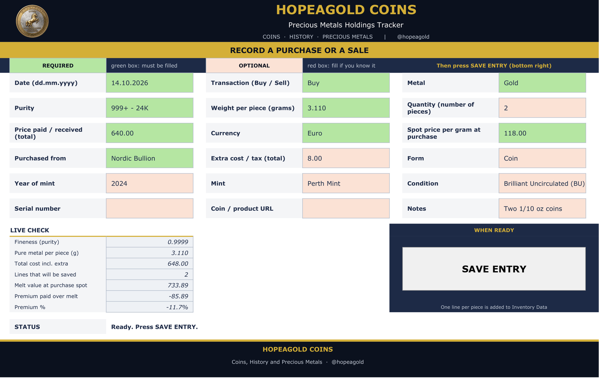
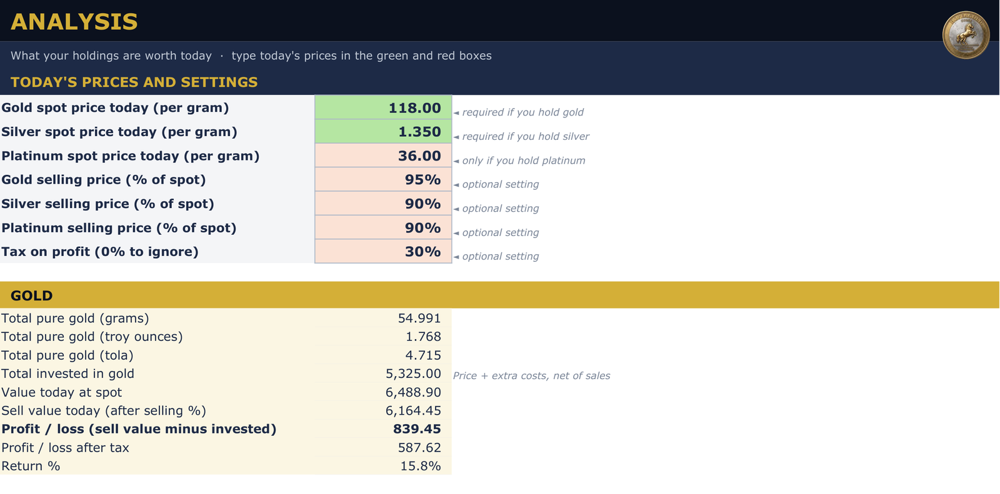
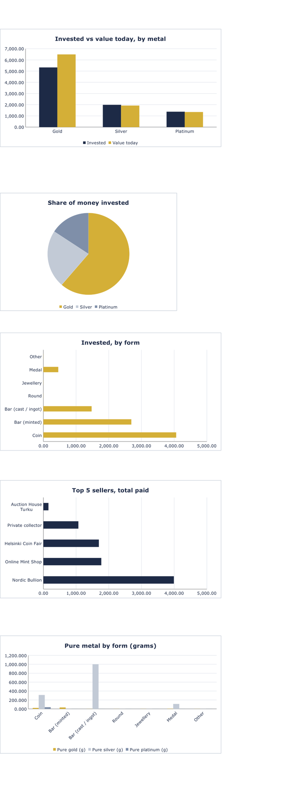
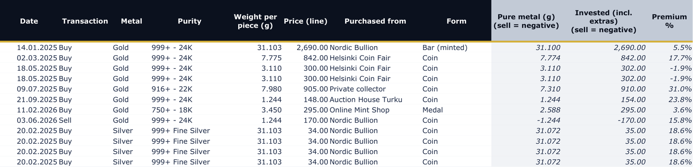
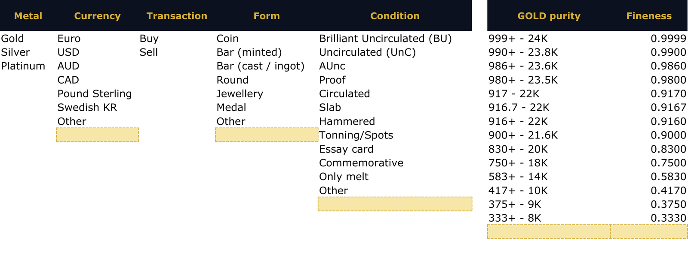
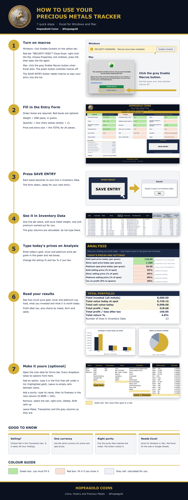

# HopeaGold Precious Metals Tracker (Excel)

**Track every gold, silver and platinum coin and bar in Excel.** One form, one button: see your pure metal, the money you invested, what it is worth today and your profit, with charts. No app, no subscription, your data stays in your own file.

### [Get the full tracker on Gumroad](https://hopeagold.gumroad.com/l/gold-silver-purchase-sheet)

> This repository contains a **view-only demo**: values only, no macros, locked sheets. The full tracker (the SAVE ENTRY button, every formula, the dropdown lists you can change, and the example file) is sold on Gumroad.

## What the full tracker does

- Record a purchase or a sale in one simple form. Green boxes are required, red boxes are optional.
- Bought several identical coins or bars? Type the quantity and it creates one line for each piece.
- Separate purity lists for gold (24K down to 8K), silver (999, Britannia, Sterling, coin silver, 800) and platinum (999, 950, 900, 850).
- Pure metal weight in grams and troy ounces, total cost including extras, melt value and premium over spot, worked out for every line.
- Enter today's price per gram to see value today, sell value, profit and profit after tax.
- Charts: invested vs value by metal, share of money invested, spending by form and your top 5 sellers.
- Keep the details of each piece: year, mint, condition, serial number, notes and a link.
- Change every dropdown (currencies, forms, conditions, purities) to your own. The three metals are fixed.

## How it works

1. Open the Entry Form and fill in the green boxes.
2. Press SAVE ENTRY. One line per piece appears in Inventory Data.
3. Open Analysis, type today's prices, and read your results.

## Try the demo

Open [`demo/HopeaGold-Precious-Metals-Tracker-DEMO.xlsx`](demo/HopeaGold-Precious-Metals-Tracker-DEMO.xlsx) in Excel to look around the real layout with sample data. It is for viewing only.

## Requirements (full tracker)

Excel for Windows or Mac (Excel 2016 or newer, or Microsoft 365). The SAVE ENTRY button uses a macro, so you need to enable macros: on Windows click Enable Content (unblock the downloaded file first), on a Mac click the grey Enable Macros button. It does not run in Excel for the web, Google Sheets or phone apps. A picture guide is included.

## Want to build it yourself? (EUR 8)

Prefer to build your own version from scratch with an AI assistant? Pay **EUR 8** at Buy Me a Coffee: **[buymeacoffee.com/hopeagold](https://buymeacoffee.com/hopeagold)** and write your email address in the message. Within 48 hours I will send you the build prompt and the Excel file.

## Support

Every buyer of the full tracker gets 1 free support question. After that, support is EUR 2 per request, and I will do my best to answer each one.

## Licence and disclaimer

Copyright (c) 2026 HopeaGold: Coins, History and Precious Metals. All rights reserved. The demo file may be downloaded and viewed for personal evaluation only; do not copy, redistribute, resell or reuse it or the design of the full product. See [LICENSE](LICENSE).

This is a record-keeping tool. Values depend on the prices you enter and are estimates. It is not financial, investment or tax advice. Microsoft Excel is a trademark of Microsoft Corporation; this product is independent and is not affiliated with or endorsed by Microsoft.

## About HopeaGold: Coins, History and Precious Metals

HopeaGold: Coins, History and Precious Metals is a Finland-based collector brand for silver and gold coins and precious metals. "Hopea" is Finnish for silver, and the name plays on "hope a gold". [Facebook](https://www.facebook.com/hopeagold) · [YouTube](https://www.youtube.com/@hopeagold) · [X](https://x.com/hopeagold) · [Instagram](https://www.instagram.com/hopeagold/) · [Gumroad store](https://hopeagold.gumroad.com/) · [Buy me a coffee](https://buymeacoffee.com/hopeagold)

`#preciousmetals` `#silverstacking` `#bullion` `#coincollecting` `#exceltemplate` `#spreadsheet` `#portfoliotracker` `#numismatics`
